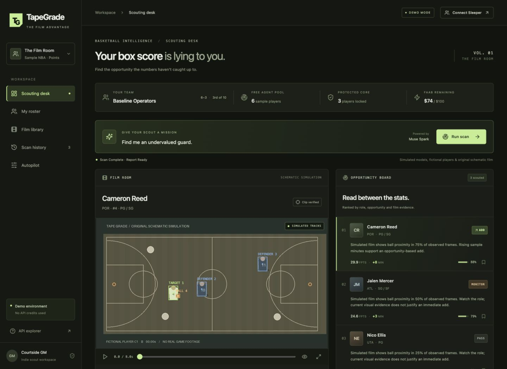
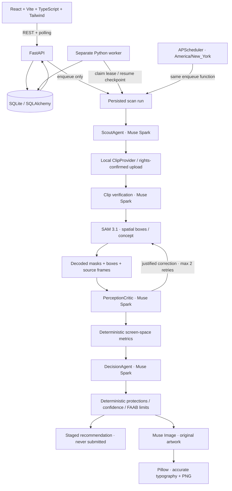

# TapeGrade

**Your box score is lying to you.**

An autonomous fantasy basketball scouting desk: shortlist players, inspect film,
challenge tracking mistakes, measure evidence, and stage a guarded roster move.
Built for the Meta Global AI Developer Hackathon, Indie Developer track.



TapeGrade runs locally for one user. The API rejects remote clients and untrusted
browser origins. Keep both servers on loopback and do not expose them through a
proxy or tunnel. See [security and hosting boundaries](SECURITY.md).

## Start here

The normal workflow is **connect your league → run a live scan → review the report**.
Live scans refresh the Sleeper roster, update game logs older than 60 minutes,
shortlist players, look for permitted footage and build a report with actual Meta
API clients. They never fall back to simulated analysis. API and data credentials
stay on the server.

Start the bounded live profile with `bash scripts/dev-live.sh`, connect your NBA
league in the app, and choose **Run live scan**. It allows one candidate, five-second
clips, no automatic tracking retries and at most six model calls. Existing scoring
confirmations and protections are preserved during roster refreshes. A new league
with ambiguous scoring rules may need one initial rule confirmation.

Automatic footage processing uses existing uploads, an **authorized footage catalog**,
or user-enabled public ESPN highlights. With `PUBLIC_FOOTAGE_ANALYSIS_ENABLED=1`,
a recent player-specific direct MP4 is imported as a short excerpt with attribution,
then checked for identity and tracking quality. Authentication and DRM restrictions
are never bypassed. Sources without usable media remain viewing links and do not
contribute film measurements. See [automatic footage setup](docs/AUTOMATIC_SCANNING.md).

For the no-account, no-credit fictional demonstration, explicitly start
`bash scripts/dev-demo.sh`. Keep demo and live results distinct.

The entire mock demonstration runs without accounts, API keys, third-party data,
or downloaded sports footage. It uses **fictional players and statistics**, original
procedural basketball footage, and deterministic simulated model responses.

The actual Meta clients are implemented and covered by **offline HTTP contract
tests**. See `PROGRESS.md` for implementation status and validation boundaries.
Permitted video input is required for a full three-model live scan.

### macOS prerequisites

- Python **3.12**.
- Node.js **22 LTS or newer** and npm.
- `ffmpeg` and `ffprobe` on PATH.
- Three terminals, or the combined development script below.

With [Homebrew](https://brew.sh/) installed:

```bash
brew install python@3.12 node@22 ffmpeg
```

If Node 22 is not on your PATH, use Homebrew's displayed PATH instructions.
Confirm `python3.12 --version`, `node --version`, and `ffmpeg -version`.

### Install

From the project root:

```bash
python3.12 -m venv .venv
.venv/bin/python -m pip install -r backend/requirements.lock.txt
npm --prefix frontend ci
```

Or run `bash scripts/setup.sh`. It performs the same installation and leaves
your environment file alone. The lock files record the dependencies tested here;
`backend/requirements.txt` lists the top-level compatibility ranges.

### Environment

The explicit demo launcher runs without `.env`. Live mode is the default; configure
it by **manually** copying `.env.example` to `.env` if you do not already have one,
and edit it. Never overwrite an existing file containing your key.

```bash
git check-ignore .env
```

This must print `.env`. `.env`, `.env.*` (except `.env.example`), environments,
SQLite databases, media caches, uploads, builds, and node_modules are ignored.
The backend loads `.env` from the repository root regardless of the launch directory.
No credential is returned to React, embedded in a URL, or stored in a Tape Card.
Only a boolean indicating whether a key is configured is exposed.

### Run — three terminals

All commands below run from the **repository root**. You do not need to activate
the virtual environment when using these exact commands.

Terminal 1 — API:

```bash
.venv/bin/python -m uvicorn backend.main:app --host 127.0.0.1 --port 8000 --reload
```

Terminal 2 — separate persistent worker:

```bash
.venv/bin/python -m backend.worker.scan
```

Terminal 3 — React:

```bash
npm --prefix frontend run dev
```

Open [TapeGrade](http://localhost:5173). Interactive endpoint documentation is at
[FastAPI docs](http://localhost:8000/docs).

Alternatively, `bash scripts/dev.sh` starts all three together; Ctrl+C stops them.
It uses the same entry points, without backend hot reload. macOS must remain awake
for local jobs and schedules to run. Nothing is deployed or pushed.

### First demonstration

1. Start `bash scripts/dev-demo.sh` (`MOCK_MODELS=1`, `DEMO_MODE=1`).
2. Open the dashboard. The fictional **Film Room** NBA league loads automatically.
3. Enter **Find me an undervalued guard.** and click **Run scan**.
4. The worker generates the original eight-second schematic clips on first use.
5. Cameron Reed, Jalen Mercer, and Nico Ellis are shortlisted. Cameron's first
   simulated tracking attempt swaps identities halfway through the clip.
6. The critic scores it 46%, refines the prompt to **cream basketball jersey number 4**,
   and reruns SAM. The simulated corrected track scores 91%.
7. Play/seek the video, toggle overlays, and select another candidate. Inspect the
   measurement methodology and source frame indices.
8. The default settings produce **ADD Cameron Reed / DROP Theo Martin / FAAB $8**,
   with **Awaiting your tap**. The film findings determine the verdict.
9. Download the 1080×1350 PNG Tape Card. Copy the clearly labeled move summary.
10. Try **Autopilot**, protect Theo, and save: the old staged move is withdrawn.
    Lower the bid limit and rescan to see the backend enforce it.

The first scan takes longer because ffmpeg creates media. Repeat scans reuse cached
outputs and explicitly log cache hits. For the unmodified full-demo path, retain
the default guardrails and sample clip selection. Uploading a clip for a shortlisted
player makes that upload the next selected source; mock identity verification then
rejects it honestly. Use a different player for an upload demonstration, or move
your local database aside while all processes are stopped to start a clean workspace.

## Architecture



### Directory guide

| Path | Responsibility |
| --- | --- |
| `frontend/src/pages` | Dashboard, film library, settings |
| `frontend/src/components` | Film player, overlays, candidates, critic log, roster, card |
| `frontend/src/hooks` | API state, scan polling and history selection |
| `backend/api` | REST contracts, uploads, settings, results and downloads |
| `backend/agents` | Scout, perception critic and fantasy decision orchestration |
| `backend/models` | Interfaces, deterministic mocks and actual Meta HTTP clients |
| `backend/providers` | Sample basketball league, documented Sleeper reads, points scoring |
| `backend/services` | Clips, geometric metrics, overlays, staging validation, cards |
| `backend/db` | SQLite setup and relational persistence |
| `backend/worker` | Atomic job leases, resumable pipeline, scheduler entry point |
| `data/samples` | Automatically generated original sample footage |
| `data/cache` | Frames, raw SAM output, decoded masks, overlays and PNG cards |
| `data/uploads` | Locally normalized, rights-confirmed user video |
| `tests` | Offline backend, pipeline and documented-client contract tests |

SQLite stores users, leagues, players, roster snapshots, watchlists, clips,
segmentation results, perception attempts, calculated metrics, verdicts, staged
moves, settings, scan runs, events, model call accounting and cache records. Foreign
keys, per-scan unique constraints and cache keys prevent duplicate result rows.
The database uses WAL and a busy timeout for the API and worker processes.

### The three Meta contributions

| Model | Actual live responsibility | Mock behavior |
| --- | --- | --- |
| `muse-spark-1.3` | Schema-constrained shortlisting, visible clip identity verification, overlay criticism, evidence-based decisions | Deterministic position/minute ranking, explicit synthetic identity-swap case, metric-driven verdicts |
| `sam-3.1` | Video segmentation via Responses API; source-frame IDs, stable per-response object IDs, decoded masks, boxes and centroids | Reproducible observations from the original scene geometry |
| `muse-image-1.0` | Generate editorial court artwork for the Tape Card | Locally rendered, labeled mock artwork |

Typography and verified measurements are always composited locally. Generated
artwork is decorative, never evidence for a measured statistic.

## Enable actual Meta inference

For a first check with minimal usage, run:

```bash
.venv/bin/python -m scripts.live_check
```

This checks the backend credential against Meta's documented model catalog, without
running inference. It never displays the key. To explicitly run **one** Muse Spark
structured-output check through the actual client and ScoutAgent:

```bash
.venv/bin/python -m scripts.live_check --spark
```

The optional call uses fictional data, minimal reasoning and a 512-token output
cap; it makes no automatic retry and does not invoke SAM or Muse Image. Repeating
`--spark` makes another request. Its sanitized result and API-reported token usage
are written to ignored `data/cache/live-check.json`. This is a connectivity/schema
check, not a film analysis or roster recommendation.

Launch the app with a temporary low-usage profile:

```bash
bash scripts/dev-live.sh
```

This leaves `.env` unchanged and starts the API, worker and frontend with live
models and the selected league, **one candidate, up to two distinct clips, no
same-clip SAM retries, a six-call scan limit, five-second clips, 2048 output
tokens per Spark call, minimal reasoning, and scheduling disabled**. The call
limit is not a dollar estimate. Connected league scans refresh roster/statistics
and discover matching footage automatically; permitted uploads and the footage
catalog are also supported. When identity, tracking or measurable evidence is
unclear, the worker switches to another eligible clip if the remaining budget
can cover it and the final report. A shared identity check lets a named-player
two-clip scan complete within six calls. Earlier scouting/candidate calls reduce
the remaining headroom. Duplicate footage is excluded and uncertain evidence
never becomes an ADD. The report explains each clip check and any budget or
availability limit. See [Automatic scanning](docs/AUTOMATIC_SCANNING.md).

On November 3 all three actual clients completed requests on a user-provided
four-second highlight excerpt. SAM returned 48 frames; Spark detected degraded
defender tracking and assigned 55% quality, so numerical film proxies were withheld.
Muse Image generated the diagnostic card artwork. This validates the integrations,
not full-game tracking accuracy or an evidence-based fantasy transaction. The
shipped schematic sample remains marked simulated.

[Video discovery notes](docs/VIDEO_SOURCES.md) list official ESPN/SportsCenter viewing
links and two short archival samples with listed Creative Commons licenses. These
historical clips are integration-test candidates, not current fantasy evidence.
The attempted sample download was rate-limited; no clip was downloaded or imported.
Discovery links alone do not provide a video file or establish processing rights.

### Test a long local video without sending the whole file

The browser uploader still limits source files to 100 MB / 10 minutes. For a longer
local MP4/MOV (up to one hour), the clip utility extracts a 1–5 second excerpt first.
The original stays local, audio is removed, and only the normalized excerpt and
sampled frames can be sent to Meta. Start `bash scripts/dev-live.sh`, then in another
terminal run:

```bash
MOCK_MODELS=0 MAX_CLIP_SECONDS=5 .venv/bin/python -m scripts.film_check \
  "/absolute/path/to/highlights.mp4" --start 4 --duration 4 \
  --subject "Visible ball handler" --team GSW \
  --description "Black-and-yellow uniformed player with yellow shoes, dribbling at the far left wing in frame zero. No real name or jersey number asserted." \
  --execute
```

Inspect the selected frame before choosing its visual description. Without
`--execute`, this command only prepares media locally and makes no model calls.
With `--execute`, the persistent worker performs at most **four** requests: Spark
verification, SAM tracking, Spark criticism and one Muse Image background. Rejected
verification skips the remaining calls. Identical input reuses the existing job.

The report appears on the scouting desk and in scan history as a **film diagnostic**.
Real-name identity, game date and fantasy statistics stay unverified; no add/drop or
FAAB transaction is produced. A MONITOR label means review this diagnostic, not a
fantasy recommendation. The card labels AI tracking quality and observed frame
count when reliable fantasy film metrics are unavailable.

No automatic paid retry occurs after a failed response. The explicit **Retry scan**
button, or the same command with `--execute --retry`, permits up to two additional
attempts and at most six total for that diagnostic. Successful tracking and other
saved outputs are retained. Perception-driven re-segmentation remains disabled in
this budget-limited diagnostic; normal scouting jobs implement the bounded critic
loop. Never relabel a real athlete as a fictional demo player to bypass verification.

Official documentation was inspected before implementing these request contracts:

- [Meta overview and available models](https://dev.meta.ai/docs/overview)
- [Structured output](https://dev.meta.ai/docs/structured-output)
- [Image understanding](https://dev.meta.ai/docs/image-understanding)
- [SAM overview](https://dev.meta.ai/docs/sam/overview)
- [Segmentation requests and spatial prompts](https://dev.meta.ai/docs/sam/segmenting)
- [SAM output grammar](https://dev.meta.ai/docs/sam/reading-segmentation)
- [Official SAM parser](https://dev.meta.ai/docs/sam/client-libraries)
- [Muse Image generation](https://dev.meta.ai/docs/image-generation)

In your manually created `.env`:

```dotenv
MODEL_API_KEY= # fill in your existing key locally
MOCK_MODELS=0
DEMO_MODE=1
MAX_CANDIDATES=1
MAX_SAM_RETRIES=2
MAX_LIVE_MODEL_CALLS_PER_SCAN=15
```

Restart **both** the API and worker. `MOCK_MODELS` controls model inference;
`DEMO_MODE=1` permits sample-league scans. The selected league workspace is saved
separately in SQLite. Real models can analyze the clearly labeled sample league,
and a Sleeper roster can be viewed without invoking any Meta model. Connected NBA
recommendations remain disabled until recent unrostered-player statistics are added.

1. Verify your account can access the three model IDs. Default API origin:
   `https://api.meta.ai` (`/v1` is appended by the transport).
2. Upload MP4/MOV footage through **Film library**, choose a target, and confirm
   processing rights. These uploads and selected frames are sent to Meta in live
   mode. No video is automatically downloaded from YouTube.
3. Target identity must match visible evidence. The shipped players are fictional;
   do not upload a real athlete's clip and assert it is Cameron Reed. You may use
   your own clearly identified fictional-player footage, or adapt
   `DemoLeagueProvider` to your own permitted player data **before initializing a
   fresh database**. Statistics in that provider must retain their honest source.
4. Set `MAX_CANDIDATES=1` for an initial inexpensive manual test. The budget counts
   actual attempted inference calls, persists across retries and excludes cache hits.
5. Run a scan yourself. Accepted footage triggers Spark verification, spatial SAM
   tracking, Spark criticism and any justified retry, metric calculations, the
   decision, and Muse Image artwork generation.

Spark uses `POST /v1/chat/completions` with `response_format.json_schema` and Pydantic
validation. SAM uses streamed `POST /v1/responses`, `input_video.video_url` as a local
base64 data URL, and `metadata.mask_encoding=one_bit`. Verified frame-zero boxes
are encoded with the official `meta-sam-parser` prompt builder. The critic sees raw
sampled frames alongside generated overlays. Its **actual corrected prompt** is
passed to the next SAM call; there is no forced failure in live mode.

The official parser handles frame order, sparse object IDs, boxes, and base85 mask
payloads. Box-local masks become PNGs; boxes and source frame indices are preserved.
A refined concept prompt can identify one target, but cannot establish defender or
ball roles by itself. Such missing roles produce unavailable metrics.

Muse Image uses `POST /v1/images/generations`, one image, base64 PNG output. If image
generation alone fails, the report remains available with an explicit card error.
Missing models, invalid schemas, rejected clips, low-quality tracking, exhausted
budgets and network errors are surfaced without substituting mock results.

Timeouts are bounded. There is **no automatic replay of ambiguous paid requests**:
a timeout may still have been billed. Correct the issue and use **Retry scan**
manually. Completed operations are cached; at most two perception-driven SAM
retries are allowed. Caches include mode, model ID, clip hash, prompt/seed
configuration and operation/schema. Changing inputs invalidates the relevant cache.

## Honest film metrics

| Metric | Implemented computation | Limitations |
| --- | --- | --- |
| Nearest defender | Mean minimum distance between target and identified-defender box centroids | Screen pixels; camera perspective and framing affect it. Never feet. |
| On-ball involvement | Fraction of jointly observed target/ball frames within 0.8 target-box heights | A proximity proxy, not possession, touches or official usage. |
| Shot opportunity | **Unavailable** | Requires reliable rim localization, action understanding and calibration. |
| Defensive activity | **Unavailable** | Requires possession context and camera-motion compensation. |

At least four reliable joint observations and perception quality ≥60% are required.
Metric confidence is deliberately capped; source frame indices and explanations are
stored and visible. Missing values are `null`, never fabricated zeros. ADD requires
verified footage, perception quality ≥75%, nonempty references to measured metrics,
and the user's confidence threshold. A short selected clip is not representative
of an entire game. These are decision-support signals, not validated predictions.

## Sleeper integration

[Sleeper's official documentation](https://docs.sleeper.com/#get-all-leagues-for-user)
lists NFL-only automatic league discovery. On November 4, direct documented
league-ID, roster, user, player-map and matchup reads successfully returned actual
NBA data for a user-supplied league. TapeGrade labels this **observed NBA compatibility**,
not a guarantee of officially supported NBA discovery. Implemented reads are:

- `GET /v1/user/{username}`
- `GET /v1/user/{user_id}/leagues/nfl/{season}`
- `GET /v1/league/{league_id}`
- `GET /v1/league/{league_id}/rosters`
- `GET /v1/league/{league_id}/users`
- `GET /v1/players/nba` (the documented `/players/{sport}` route)
- `GET /v1/league/{league_id}/matchups/{period}`

To connect an NBA league:

1. Click **Connect Sleeper**, enter your username and the numeric **NBA league ID**
   from its URL, then click **Connect NBA league**. No password or API key is needed.
2. TapeGrade verifies roster ownership/co-ownership, imports the actual player names,
   positions, teams, lineup/injury labels, scoring weights and reported period points,
   then opens **My roster**. The connection survives API/browser restarts.
3. **PERIOD N FPTS** are the values returned in Sleeper's matchup `players_points`.
   Team points use the API's reported total/custom override. These are not season
   averages, recent per-game production or projections. Zero is preserved only when
   reported; missing points stay unavailable. No raw box-score or bonus calculation
   is inferred from these totals.
4. Use **Connect Sleeper → Refresh league** to refresh. Account/league reads cache
   for five minutes; the player directory is cached on disk for 24 hours as requested
   by the documentation. No Meta requests occur during connection or refresh.
5. Use **Continue with the sample NBA league** in that dialog to return to the full
   mock/scouting demonstration. Each workspace keeps its own history, watchlist and
   guardrails. Existing jobs keep the guardrails of their original league.

The unrostered pool excludes every team's players/reserves/taxi entries and includes
only active players with a returned team. This is roster-derived availability, not
proof of waiver eligibility. Recent minutes, box scores and trends are unavailable.
**Recommendation scans for this connection are blocked before any model call**
until a verified recent-statistics feed is added. Mock models cannot fabricate
numbers or recommendations for the connected real roster. Scheduling also skips it.

Leaving the league ID blank retains public account/NFL league discovery and view-only
NFL reads. Missing users, mismatched ownership, malformed responses, unsupported
sports and rate limits produce explicit errors. Failed matchup reads preserve roster
access while marking points unavailable. API licensing terms apply; no transaction
submission endpoint or code exists.

## Jobs, recovery and schedules

Stages are persisted as QUEUED → SCOUTING → FINDING_CLIPS → VERIFYING → TRACKING ↔
CRITIQUING → CALCULATING_METRICS → DECIDING → GENERATING_CARD → COMPLETED / FAILED.
Tracking stages repeat per candidate. HTTP scan creation returns immediately.

- A worker atomically claims a job with a token and ten-minute lease.
- A heartbeat renews ownership around expensive operations; model timeouts are shorter.
- After a crash, an expired lease is eligible for another worker. Candidate
  checkpoints and model caches reuse completed work; unique result keys prevent
  duplicate verdicts/metrics. Retry a FAILED run through the UI or API.
- Changing model mode does not convert existing jobs: restore the original mode
  or start a new scan. A failed request's budget remains spent.
- Run one local worker by default. A future multi-host deployment should replace
  local SQLite/media with shared storage and stronger distributed ownership.

Scheduling requires **both** `SCHEDULER_ENABLED=1` in the worker environment and
**Nightly scan** enabled in Autopilot settings. Default: off. The worker runs an
APScheduler cron at **1:30 AM America/New_York**. The optional pre-waiver hour is
read from saved settings each hour. ZoneInfo handles offset changes; a unique
date-and-slot request key avoids duplicate jobs on the repeated DST hour. Jobs
missed while the computer was asleep are not guaranteed to backfill; use a manual
scan. There is no cloud cron or always-awake host in this version.

For future Modal scheduling, `backend.worker.scheduler.scheduled_scan(slot)` is
the reusable guarded enqueue entry point. `backend.worker.scan.run_once()` claims
and processes a queued job; `.venv/bin/python -m backend.worker.scan --once` is its
CLI equivalent. A Modal adapter must mount shared persistent DB/media storage and
configure scheduling explicitly; no Modal account or deployment is included.
`backend/services/notifications.py` is a local logging hook ready for opt-in email
or Telegram. It currently sends nothing externally.

## Tests and verification

```bash
.venv/bin/python -m pytest -q
npm --prefix frontend test
npm --prefix frontend run build
```

With all three services running in default mock mode:

```bash
.venv/bin/python scripts/smoke.py
```

The HTTP smoke test checks frontend serving/proxying, queued worker execution,
results, metric references, guardrails, video range serving and PNG download. It
**refuses live mode**. All Python tests block external HTTP, use isolated temporary
databases/media, and override model credentials. No paid API tests run automatically.

Coverage includes routes, settings persistence, idempotency, recovery and lease
exclusion, bounded perception retries, protected drops, bid/budget caps, structured
responses, missing metrics, cache reuse, mock/live isolation, SAM grammar/mask
decoding, incomplete streams, sanitized API errors, supported Sleeper paths, DST,
and a rights-confirmed upload. An offline live-client pipeline fixture exercises
all three real clients and verifies that criticism changes the subsequent SAM
request; it is a contract test, **not proof of paid inference quality**.

React tests cover scan submission/polling, persisted result display, empty states,
overlay toggling, unavailable metrics, copied demo labels, settings and errors.
Desktop and 390px mobile layouts were inspected in the local browser; video
playback and candidate switching were exercised. See `PROGRESS.md` for final results.

Optional development formatting: install `backend/requirements-dev.txt`, then run
`.venv/bin/python -m black backend tests scripts`. React/CSS formatting is available
with `npm exec --prefix frontend -- prettier --write frontend/src`.

### Troubleshooting

- **Scan stays QUEUED:** start the separate worker in the same root/environment.
- **Backend unavailable:** check port 8000, terminal errors, and the `.venv` command.
- **Port already in use:** stop your previous process with Ctrl+C. Vite refuses to
  silently switch ports because the app expects 5173.
- **Video processing fails:** check both ffmpeg and ffprobe are on PATH.
- **No recommended move:** review protected players, confidence, clip verification
  and metric availability. The agent deliberately abstains instead of forcing one.
- **Uploaded real video rejected in mock mode:** expected; deterministic mocks
  cannot verify real identities. Real footage requires actual models and identity evidence.
- **Model 401/403/404:** check the key and model availability in your Meta account.
  Do not put the key in `VITE_*` variables. Start a fresh scan after configuration changes.
- **Database reset:** stop all services, move `data/tapegrade.db` and any associated
  `-wal`/`-shm` files to a backup folder, then restart. This creates a fresh sample
  workspace. Do not do this to a database you need without keeping the backup.
- **Editing the schema:** v1 uses `create_all`, not migrations. Existing database
  structure is not automatically migrated. Add Alembic before maintaining production data.

## Implemented, simulated and future work

**Implemented:** local React dashboard, points-scored demo league, SQLite persistence,
separate resumable worker, candidate reasoning, complete critic loop, original video,
uploads, tracking overlays, defensible proxies, guarded recommendations, watchlist,
history, PNGs, actual documented clients, supported Sleeper reads, local scheduler,
offline tests and smoke script.

**Simulated in a fresh sample workspace with mock models:** every player/statistic, the sample film scene, model
reasoning, tracks, identity swap and correction, and card artwork. Labels remain
visible. A connected Sleeper roster remains actual provider data even with mock
models; it cannot be scanned with fabricated statistics. Switching models to live
does not configure a statistics-provider account or grant footage rights.

**Not included:** provider subscriptions, validated prediction accuracy, official NBA tracking metrics,
reliable shot/defensive action detection, category scoring, public hosting,
authentication/multi-user isolation, Modal deployment, external notifications,
YouTube discovery/downloads, and real transactions. `YOUTUBE_API_KEY` is reserved;
no YouTube API is called. This is a localhost single-user application; do not bind
it publicly without adding authentication, upload hardening and deployment controls.

Next engineering steps: validate a rights-cleared real-film set on your Meta
account, benchmark identity continuity and mask quality, validate statistics
coverage, calibrate camera geometry, implement robust action features, introduce
schema migrations, and deploy a durable worker only after local validation.

## 2–3 minute hackathon demonstration

**0:00–0:20 — The premise.** “Your box score is lying to you. TapeGrade looks for
opportunity on film and stages a roster move. This demonstration uses fictional
players and simulated models; the same pipeline has actual Meta API clients.”

**0:20–0:45 — The mission.** Show the sample roster and protected core. Enter
“Find me an undervalued guard.” Run the scan. Point out that the API enqueues work
and a separate durable worker advances it.

**0:45–1:25 — The centerpiece.** Select Cameron, play the schematic clip and toggle
the segmentation overlay. Open the perception log: initial 46% quality, identity
swap criticism, corrected jersey prompt, second SAM attempt, 91% acceptance.
Explain that the critic changes the actual next request rather than narrating a
fixed pipeline. In a live run these entries come from actual operations; no retry
is forced.

**1:25–1:55 — Evidence to action.** Show 117.4 screen pixels of nearest-defender
distance and 75% ball-proximity involvement in this simulated sample. Explain the
proxy labels and unavailable shot metric. Contrast MONITOR and PASS candidates.
Show ADD Cameron / DROP Theo / $8 and “Awaiting your tap.”

**1:55–2:25 — The safety boundary.** Protect Theo in Autopilot, save, and show that
the staged transaction is withdrawn. Describe confidence and FAAB caps and the
absence of any transaction submission endpoint. For connected leagues, open League setup
and show the separate period/average fields, source coverage and unresolved rule evidence.
Unknown eligibility permits a scouting report but blocks an ADD or staged move.

**2:25–2:50 — Share the insight.** Download the Tape Card. In live mode Muse Image
supplies artwork for supported outcomes; low-quality normal reports use a local card.
Download the evidence JSON to show frozen source rows and the call ledger. The separate
offline contract card is visibly labeled synthetic; the earlier genuine 55% film
diagnostic is not an ADD. Pillow ensures exact names and verified numbers. End with
the three roles: SAM perceives, Spark checks and decides, Image communicates.

### Recent NBA logs and League setup

Connected leagues now expose a **League setup** page for bounded statistics refreshes,
licensed JSON import, player identity review, rule evidence and per-game logs for
roster players and free agents. Exact scoring and readiness are computed from saved
source evidence; period totals remain separately labeled. Live staging validates
protections, eligibility/locks and position fit, and supports moves without FAAB.

The Sportradar NBA v8 adapter uses shared athlete identifiers to join Sleeper
records. Statistics requests have bounded windows, request counts, timeouts and
pacing. Short samples, DNPs, unknown participation and missing foul fields remain
explicit gaps. Configure access locally; no account or trial is supplied.

League setup records the league's confirmed game mode, waiver type, budget and
bonus rules. Protections are optional overrides. Scans can produce reports while
transaction eligibility is unknown; ADD verdicts and staged moves require current
eligibility/lock evidence and verified named film. **Refresh Sleeper roster** and
**Refresh game logs** are separate controls. See
[statistics setup and current limitations](docs/STATISTICS.md).

Completed reports now download both a Tape Card PNG and auditable evidence JSON.
The offline contract demonstration is labeled synthetic and uses zero paid requests.

## License and third-party materials

The source code and original repository assets are available under the [MIT license](LICENSE).
Third-party dependencies retain their own licenses. Sports footage, statistics
feeds, publisher videos, team marks and user uploads retain their owners' rights;
they are not included in this license. The screenshots show the fictional demo.
